# **Bubble Energy Generator — a Slippery-Interface Triboelectric Nanogenerator**

<i class="fas fa-university"></i> City University of Hong Kong, Department of Mechanical Engineering &nbsp;·&nbsp; Final Year Project (MNE4068/4118), submitted May 2021 &nbsp;·&nbsp; Supervisor: Prof. WANG Zuankai

## Summary

Bubbles are everywhere in water systems and carry a small amount of mechanical energy. This project builds and characterizes a **triboelectric nanogenerator (TENG)** that converts the attachment and detachment of single air bubbles into electrical pulses. The active surface is a **slippery lubricant-impregnated porous surface (SLIPS)**: a porous PTFE membrane on indium tin oxide (ITO) glass, infused with a fluorinated oil so that water and bubbles slide on it. Main results (all from a single fabrication recipe, bubble volume about 100 µL at 8 Hz, tap water, room conditions):

- a repeatable biphasic pulse per bubble, **0.62 V and 7.23 nA on attachment** and **0.43 V and 5.81 nA on detachment** (average values), a pulse lasting about 15 ms;
- an output that **degrades gradually but does not collapse in salt water**: about 0.57 V in low-salt water, 0.34 V at normal-saline concentration (0.154 mol/L), and 0.14 V at 0.6 mol/L, close to seawater;
- a **steady output** after about 20 minutes of running, recovery after drying and 24 hours (about 0.5 V), and a flat, usable output after **120 days of storage in air** (about 0.4 V, roughly 20% lower than after 24 hours);
- **larger output at higher bubble frequency**.

The sections below state the research question, the physics that explain each result, the measurement method, and the limits of what the data support.

## 1. Background and research gap

Distributed sensors need distributed power, and the kinetic energy in rain, waves, drops, and **bubbles** is largely unused. A triboelectric nanogenerator combines **contact electrification** (two materials exchange charge when they touch and separate) with **electrostatic induction** (the changing charge distribution drives current between electrodes). The established modes are:

- **contact-separation**, where two dielectrics are brought together and pulled apart;
- **lateral sliding**, where one moves along the other;
- **single-electrode** and **freestanding** modes, where only one electrode is connected and the moving object needs no wire.

The weakness of solid-solid devices is that contact is imperfect and the surfaces wear. **Liquid-solid** devices avoid this because water conforms to the surface and does not abrade it. The droplet generator, and the **SLIPS-based droplet TENG** (reported at about 1.2 V and 20 nA, with strong antifouling and liquid-repellent behaviour), extended the idea. **Bubbles**, a gas-liquid interface moving against a solid surface under water, are less studied. Published comparisons suggest that a bubble carries more energy than a droplet of the same volume and converts it more efficiently, but harsh water (high ion concentration, microorganisms, fouling, acid or alkali) is the unresolved difficulty.

**Research question.** Can a lubricant-infused porous dielectric give a bubble-driven TENG that (a) responds quickly to single bubbles, (b) tolerates high ion concentration, and (c) stays stable over time?

**Hypotheses tested.**

1. *The lubricant layer makes attachment and detachment fast and repeatable,* so each bubble gives a clean biphasic pulse.
2. *Output falls with ion concentration because the double layer is compressed, but the slippery surface prevents failure.*
3. *The output is stable over long operation and storage,* since the liquid layer protects the dielectric.
4. *Output increases with bubble frequency,* up to a limit where single events can no longer be resolved.

## 2. Theory

### 2.1 Charging and the electrical double layer

When a dielectric touches water it acquires surface charge by electron transfer, ion transfer, or transfer of material. For **hydrophobic** surfaces such as PTFE, electron transfer is believed to dominate; for hydrophilic surfaces, ion transfer. PTFE is the most electronegative common polymer in the triboelectric series, and its surface typically charges negatively in water (the isoelectric point is near pH 3 to 4, where adsorption of OH⁻ exceeds that of H⁺).

The surface charge is balanced by counter-ions in the liquid, forming the **electrical double layer (EDL)**: a compact Stern layer of immobile ions and a diffuse layer of mobile ions. In the Gouy-Chapman picture the diffuse layer decays exponentially with the **Debye length**,

$$
\lambda_D=\sqrt{\frac{\varepsilon_r\varepsilon_0 k_BT}{2N_Ae^2I}}\;\approx\;\frac{0.304}{\sqrt{I\,[\text{mol/L}]}}\ \text{nm}\quad(\text{1:1 electrolyte, }25\,^\circ\text{C}),
$$

where $I$ is the ionic strength. Salt makes the double layer thinner:

| Condition | Ionic strength $I$ | Debye length $\lambda_D$ |
| --- | --- | --- |
| Tap water (this work) | 3.1 mmol/L | 5.5 nm |
| NaCl | 0.1 mol/L | 0.96 nm |
| NaCl, normal saline | 0.154 mol/L | 0.77 nm |
| NaCl, near seawater | 0.6 mol/L | 0.39 nm |

A bubble that attaches removes the liquid, and its counter-ions, from part of the surface and a bubble that leaves lets the double layer re-form. The electrode underneath sees a changing induced charge. Higher ion concentration compresses the diffuse layer by more than an order of magnitude over the tested range, so the same bubble motion rearranges less charge: **a qualitative reason to expect a falling output with salt**, as observed.

### 2.2 A circuit view of the device

Electrically the device is a capacitor, the PTFE and lubricant layers between the ITO electrode and the liquid, whose charge is changed by the bubble. For any such source the open-circuit voltage $V_{oc}$ and the short-circuit current $I_{sc}$ satisfy $V=V_{oc}-R\,I$ with the source impedance $R$ set by the layer capacitance and the pulse timescale. Two consequences matter for measurement:

- The **instantaneous electrical power** delivered to a matched load is at most of order $V_{oc}I_{sc}/4$, so the product $V_{oc}\times I_{sc}$ is an upper-bound scale for power, not a measurement of it.
- A **10 MΩ voltage probe** in parallel with a source impedance that can itself be of the order of megaohms to gigaohms forms a voltage divider. The measured "open-circuit" voltage is therefore a lower bound on the true open-circuit voltage.

### 2.3 Bubble mechanics

A bubble of volume 100 µL has an equivalent diameter $d=(6V/\pi)^{1/3}=5.76$ mm, which matches the 6.0 mm nozzle. Its Eötvös (Bond) number is

$$
Eo=\frac{\rho g d^2}{\sigma}=\frac{998\times9.81\times(5.76\times10^{-3})^2}{0.072}\approx4.5 ,
$$

so buoyancy ($\rho gV\approx0.98$ mN) outweighs the surface-tension force at the contact line scale ($\pi d\sigma\approx1.3$ mN) and the bubble leaves a hydrophobic surface quickly once it forms. Quick release is what the lubricant is meant to ensure: without it, bubbles can stick to the PTFE and the cycle is slower and less regular.

## 3. Device and fabrication

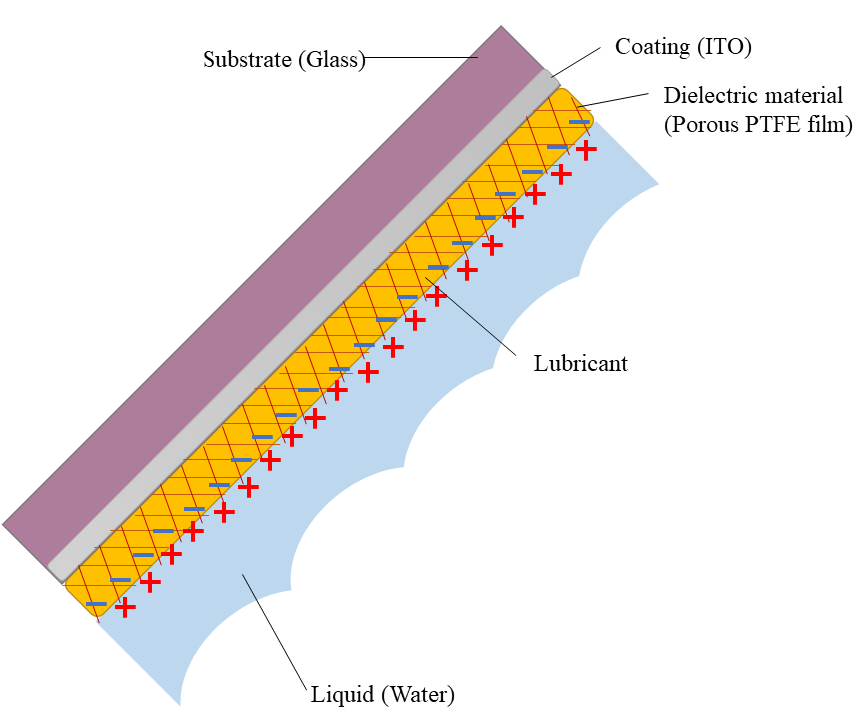
*The layer stack, from the glass substrate through the ITO electrode and the porous PTFE film to the lubricant and the water.*

- **Electrode and substrate:** ITO-coated glass slide, 3 cm × 6 cm × 2.5 mm, cleaned ultrasonically in ethanol for 5 minutes. ITO is conductive and optically transparent.
- **Dielectric:** porous PTFE membrane (Sterlitech PTU023001), 20 µm thick, 200 nm average pore size, laid on the glass after wetting with ethanol so capillary forces flatten it; the ethanol evaporates.
- **Lubricant:** DuPont Krytox GPL 103 (surface tension about 16 to 20 mN/m), added as droplets of about 25 µL that wick into the pores. Samples sat flat for about 12 hours so the oil could spread.
- **Hydrophobicity:** the water contact angle was about 120°, which indicates strong hydrophobicity.
- **Lubricant thickness:** estimated from the oil volume over the film area, $h=V/A$. With five 25 µL droplets over 1,800 mm² this gives $h=125\ \text{mm}^3/1800\ \text{mm}^2\approx69\ \mu\text{m}$. The report quotes about 100 µm; the arithmetic supports **about 70 µm**, and the layer is non-uniform and self-configuring, so the thickness should be treated as "tens of micrometres" rather than as a precise number. Excess oil (more than 5 or 6 droplets) lowered the output.

## 4. Measurement method

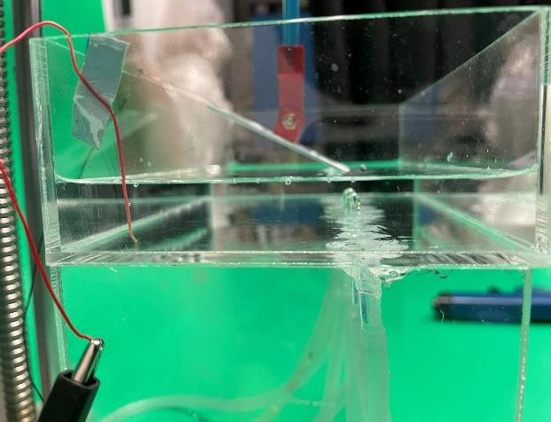
*The test rig. The device is submerged in a tank and tilted, with an air-pump nozzle underneath releasing bubbles at a controlled rate.*

- **Bubbles:** an air pump and plastic tube with a 6.0 mm inner-diameter nozzle, pump speed 800 µL/s, giving 100 µL bubbles at **8 per second (8 Hz)**; the gap between outlet and surface was 20 mm. The device was tilted at 15° so bubbles slide off.
- **Voltage:** oscilloscope (SIGLENT SDS1104X-E) with a 10 MΩ probe. **Current:** oscilloscope with a low-noise current preamplifier (Stanford Research SR570).
- **Conditions:** about 20 °C and 65% relative humidity; tap water at 3.1 mmol/L ionic strength unless stated.
- **What is reported:** representative traces and their averages. The report does not state how many devices or repeat runs were used, so there are **no error bars**, and the numbers below are best read as single-device averages (see section 6).

## 5. Results

### 5.1 One bubble, one pulse

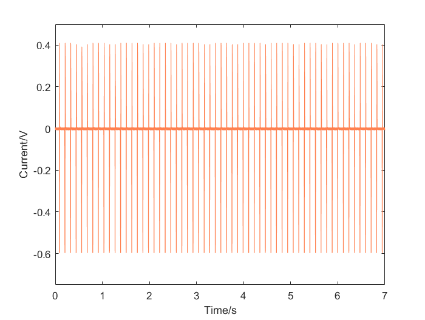
*Open-circuit voltage over seven seconds. The pulses repeat at the 8 Hz bubble frequency. (The vertical axis is labelled "Current/V" in the original figure; it is the measured voltage.)*

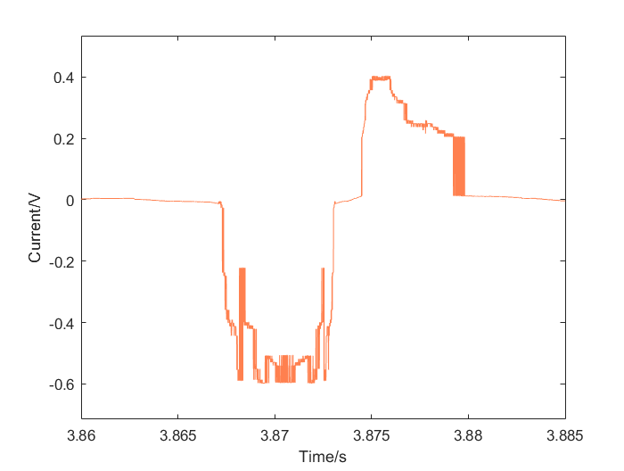
*One bubble event, expanded. The negative peak is the bubble attaching and the positive peak is it detaching; the event lasts about 15 ms.*

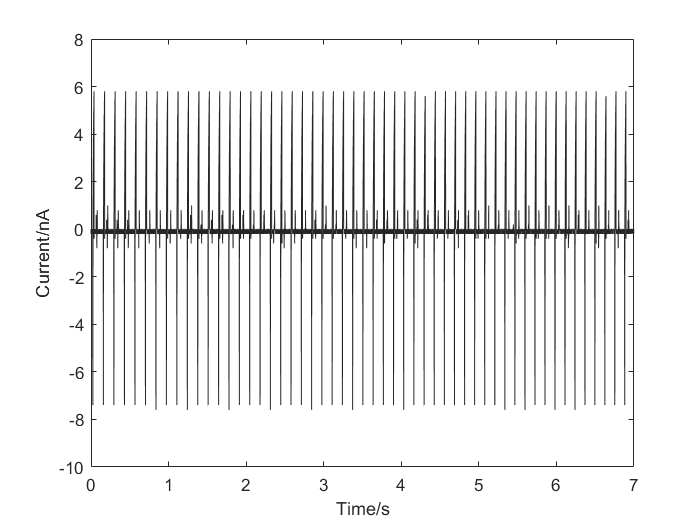
*Short-circuit current over seven seconds: positive and negative peaks of a few nanoamperes at each bubble.*

| Quantity | Attachment (absorption) | Detachment |
| --- | --- | --- |
| Average open-circuit voltage | 0.62 V | 0.43 V |
| Average short-circuit current | 7.23 nA | 5.81 nA |
| Product $V\times I$ (scale of peak power) | 4.5 nW | 2.5 nW |

The report estimates a power scale of about 3.4 nW. As an order-of-magnitude energy check, a peak power near 4.5 nW lasting about 15 ms is roughly 70 pJ per bubble, or about 0.5 nW averaged at 8 bubbles per second. These are tiny numbers, typical for a single small TENG; the design target is robustness and scalability (area, bubble count), not power from one device.

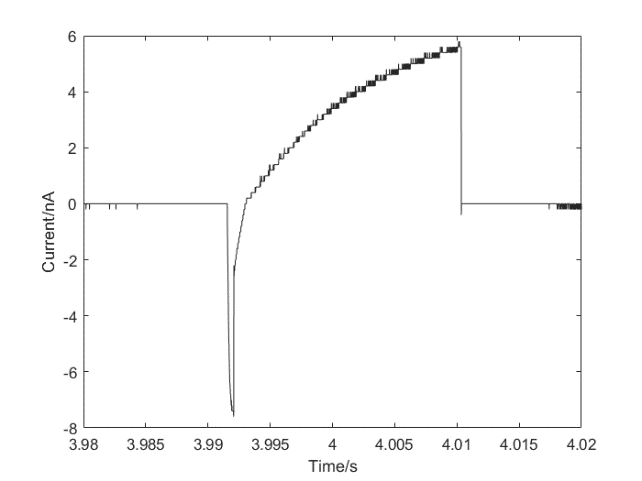
*One period of the current: a sharp negative peak on attachment of about −7 nA followed by a positive peak of about 6 nA as the bubble leaves.*

### 5.2 Mechanism

The signal has two peaks, negative first and then positive. Attachment pushes the liquid, and its ions, away from part of the dielectric, desorbing ions from the surface layer and reducing the induced charge on the electrode (a negative pulse); detachment lets the double layer re-form (a positive pulse of similar peak size). The higher and faster pulse on attachment is attributed to the more complicated water and air motion at detachment. The lubricant helps because it keeps the oil-water interface mobile, so bubbles contact and release quickly.

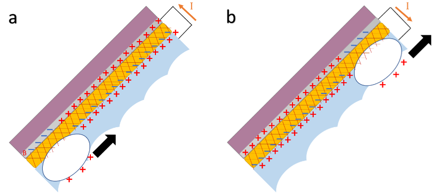
*Charge distribution as a bubble is absorbed (left) and as it detaches (right).*

### 5.3 Ion concentration

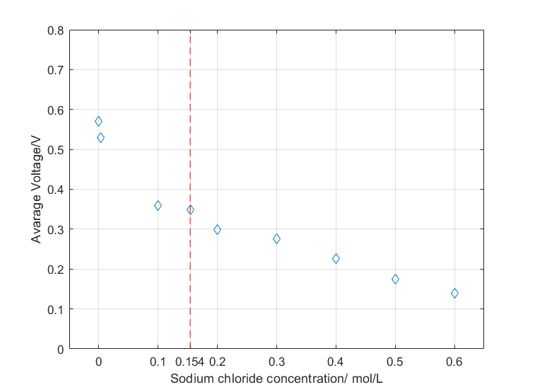
*Average output voltage against NaCl concentration. The dashed line marks 0.154 mol/L, the strength of normal saline.*

| NaCl (mol/L) | Debye length (nm) | Average output (V) |
| --- | --- | --- |
| about 0 (tap water, 3.1 mmol/L) | 5.5 | 0.57 |
| 0.1 | 0.96 | 0.36 |
| 0.154 | 0.77 | 0.34 |
| 0.6 | 0.39 | 0.14 |

Over the 0.1 to 0.6 mol/L range the output falls by about 0.30 V per decade of concentration (a straight-line fit to three points on a logarithmic axis, so descriptive only). The output is reduced to about a quarter of the low-salt value at seawater strength, but it is not zero. The report offers two mechanisms, which are not mutually exclusive:

1. Charge on the bubble surface reduces the surface tension, so at high concentration the contact area shrinks and less of the surface is involved.
2. Electron transfer, which dominates charging at a hydrophobic surface, is reduced because the higher dielectric constant of the salt solution promotes discharge after charging; strong ion-water attraction also slows the formation and deformation of the double layer.

The Debye-length column adds a third, independent reason (section 2.1): a thinner diffuse layer rearranges less charge. This work did not separate the three.

### 5.4 Stability and recovery

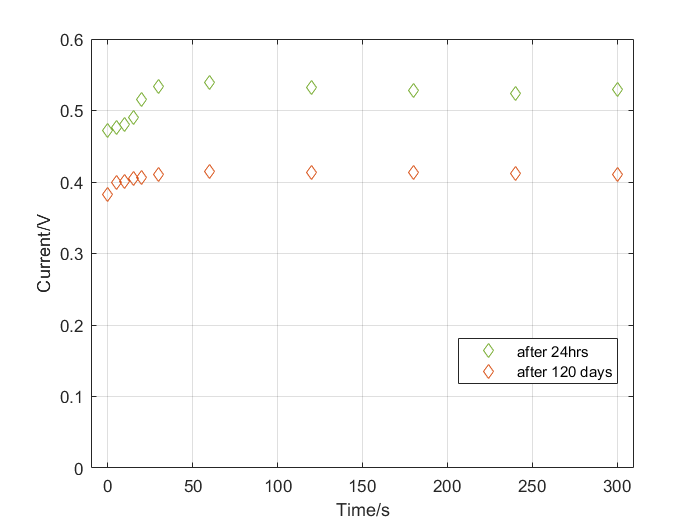
*Stability test: output voltage of the sample after drying and storing for 24 hours (green) and after 120 days (orange), over 300 s of running each.*

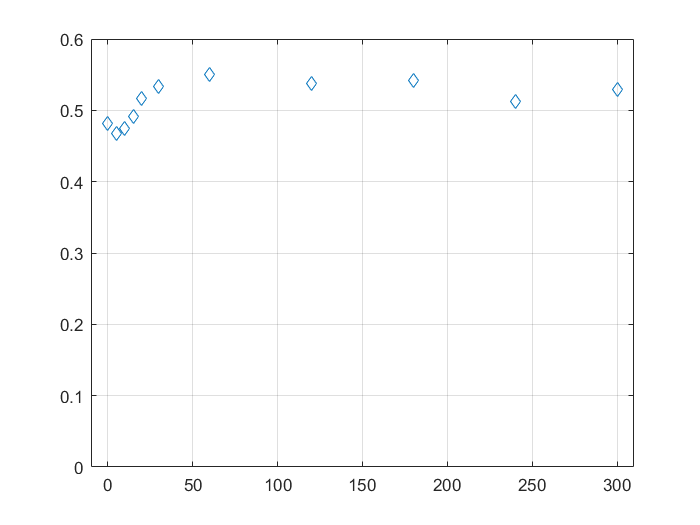
*A brand-new sample: the output rises over the first minutes to a steady value.*

A fresh sample takes about **20 minutes of running to reach a steady output**, which the report attributes to charge accumulating on the dielectric (a charging stage) before the slippery layer stabilizes. After being wiped dry and stored for 24 hours, the sample recovered to its original performance (a steady output of about 0.5 V, read from the plot). After **120 days of storage** in air the output was flat over the 300 s run but at a lower level, about 0.4 V, so roughly 20% below the 24-hour value; the report describes this as little degradation, and the plot supports "stable" but not "unchanged". The slow rise at the start of the second test is attributed to the oil redistributing during storage and the water then removing surface impurities. Impurity ions that adsorb tightly onto the film can slowly degrade the output, which is why long operation in unclean water remains an open risk.

### 5.5 Bubble frequency

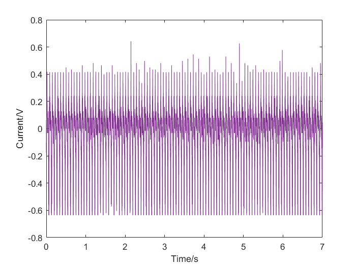
*Output at 15 Hz.*

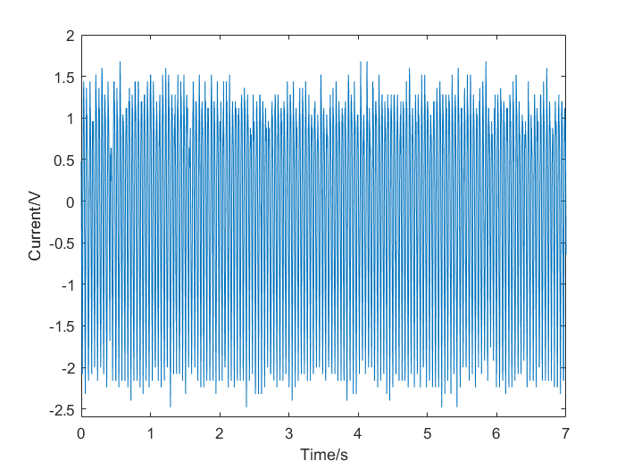
*Output for intensive bubbling: the amplitude is several times larger, but individual attachment and detachment events can no longer be resolved.*

The output voltage correlated positively with bubble frequency. At very high rates the amplitude grew several-fold, but the pulses merged, so a clean per-bubble picture is lost. The lubricant helps the high-frequency case because bubbles contact and release quickly and so give a shorter generation cycle.

## 6. Limits of the evidence

A rigorous reading of this data has to say what it does not show:

- **One device and one recipe.** No device-to-device variation or repeat statistics are reported, so the numbers carry no uncertainty estimate. A better protocol would be at least three devices, several runs each, reported as mean ± standard deviation.
- **No lubricant-free control in the written report.** The role of the oil is argued from mechanism and from the stability tests, not from a side-by-side measurement. The raw data include a no-oil recording that could be analysed to provide this comparison, and a controlled run (same film without lubricant, same bubbles, same conditions, several devices) is the decisive experiment.
- **Probe loading.** A 10 MΩ probe loads a high-impedance source, so the voltages are lower bounds; no load-resistance sweep was made, so the maximum power point is unknown.
- **Mechanism not isolated.** Electron transfer, ion transfer, and contact-area effects all predict a falling output with salt. The experiments do not separate them. The report itself says the dominant mechanism is not established.
- **Repeatable bubbles are not realistic bubbles.** Natural bubbles are irregular, so a real deployment will see variable pulses.
- **Ion type.** Only NaCl was tested; acid, alkali, and fouling are listed as future work.
- **Lubricant thickness.** The stated 100 µm is 70 µm by the plain arithmetic (section 3).

## 7. Conclusions and future work

A transparent, lubricant-infused, porous PTFE generator on ITO glass produces a repeatable biphasic pulse for every bubble, keeps most of its output in strongly saline water, and stays stable through long operation and months of storage; the output rises with bubble frequency. These are consistent with the four hypotheses, with the caveats above.

Next steps suggested by the work: treat the dielectric as a **charge reservoir** and design the interface to store more charge; replace the dielectric by a material with less abrasion and better insulation; study mechanisms directly (charge-transfer measurements in the liquid-liquid contact); improve the output so that harsh environments still give useful power; and test irregular, natural bubbles and other contaminants.

## What I learned

- **A claim needs a control.** The most important missing experiment (no lubricant) is the one that turns "it works" into "the slippery layer is why".
- **Measurement hardware shapes the data.** Probe impedance, preamplifier settings, tilt angle, and nozzle size all moved the numbers, and the instrument is part of the circuit.
- **Check the arithmetic of your own estimates.** The thickness calculation did not match the stated value, a reminder to recompute before reporting.
- **Say what is measured and what is mechanism.** The report separates traces from the explanations that fit them, and the explanations remain hypotheses.

*Thanks to Prof. Wang Zuankai for supervision, and to his PhD students Yan Xiantong and Song Yuxin for their help in the lab. The raw oscilloscope records and MATLAB figures are kept with the project files.*
