# **Optimal Gait Control of a Tendon-Driven Soft Quadruped Robot by Model-Based Reinforcement Learning**

<i class="fas fa-university"></i> KTH Royal Institute of Technology, Degree Project in Mechatronics (MF224X), 30 credits, 2023 &nbsp;·&nbsp; Examiner: Lei Feng &nbsp;·&nbsp; Supervisor: Tan Kaige

**Published as:** X. Niu, K. Tan (co-first authors), D. Gürdür Broo, and L. Feng, "Optimal Gait Control for a Tendon-driven Soft Quadruped Robot by Model-based Reinforcement Learning," *IEEE International Conference on Robotics and Automation (ICRA)*, 2025. The lab's write-up of the paper is the [Cyber-Physical Systems Lab blog post](https://cyber-physical-systems-lab.github.io/blogposts/SoftRobot.html).

## Abstract

Soft legged robots are cheap, light, and safe to be near, but their deformable bodies make them hard to model and control. We study gait control of **SoftQ**, a tendon-driven quadruped with four compressible soft legs, by **model-based reinforcement learning (MBRL)**. A neural-network **surrogate model** trained on simulation data replaces the slow high-fidelity simulator during most of the learning; a Soft Actor-Critic agent learns a walking gait inside the surrogate; the policy is then **post-trained in the accurate Simscape model** with a short expert-gait warm start, and deployed on the real robot. Compared with model-free reinforcement learning in the same simulator and with an expert trot controller, the learned gait is faster, more stable, and more energy-efficient, and it transfers to the physical robot.

## Highlights

- **Surrogate-guided SAC plus post-training.** The policy converges quickly on the proxy model, and post-training then closes the reality gap in the accurate simulator.
- **Smaller problem through parametrization.** Gait parametrization and inverse kinematics shrink the action space from twelve motor targets to four numbers, and the state to what the robot can sense, which improves training efficiency and safety.

## Why soft quadrupeds

- **Affordability.** The soft actuators are 3D-printable and cheap to fabricate and replace.
- **Efficiency.** Low mass reduces the energy needed for locomotion.
- **Safety.** A lightweight, compliant robot is safe to interact with in unstructured, dynamic environments.

The price is that the body deforms continuously, so there is no clean low-order model, and a physically accurate simulation of the soft legs is slow. That tension (cheap robot, expensive simulator) is what the surrogate model addresses.

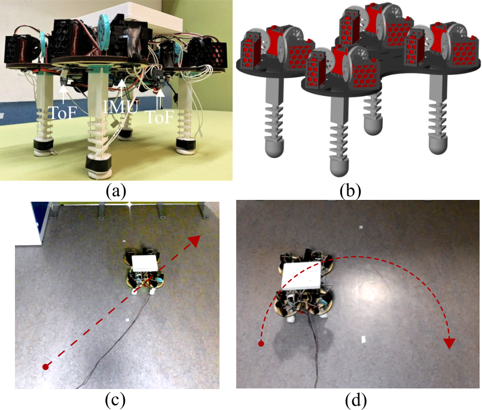
*SoftQ. (a) The real robot with its sensors, (b) the simulation model, and (c, d) a straight and a curved path followed under control.*

## The robot and its kinematics

SoftQ has four legs, each a **compressible tendon-driven soft actuator (CTSA)**: a rigid thigh, then a stack of rigid triangular disks separated by a flexible core, with three tendons routed through guide holes in the disks. Each tendon is pulled by one servo motor, so the robot has **12 actuators**. Pulling the three tendons by different amounts **bends** a leg; pulling them equally **compresses** it.

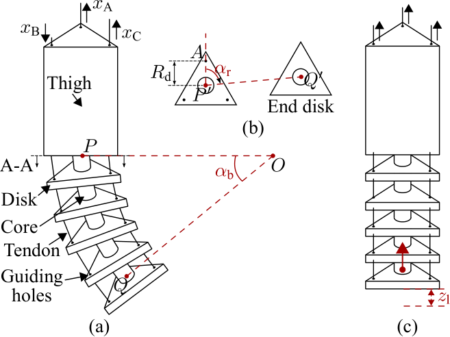
*A soft leg. (a) Bending angle $\alpha_b$ of the compressible part below the rigid thigh; (b) top view: rotation angle $\alpha_r$ of the bending plane and the circle of radius $R_d$ through the three tendon guide holes; (c) compression length $z_l$ from pulling all tendons equally.*

A leg pose is three numbers: bending angle $\alpha_b$, rotation angle $\alpha_r$ of the bending direction, and compression length $z_l$. The three tendon displacements $x_A,x_B,x_C$ (positive means the tendon is pulled) follow from the **inverse kinematics**, derived by geometric analysis:

$$
x_A=R_d\,\alpha_b\cos\alpha_r,\qquad
x_B=R_d\,\alpha_b\cos\!\Big(\alpha_r+\tfrac{2\pi}{3}\Big),\qquad
x_C=R_d\,\alpha_b\cos\!\Big(\alpha_r+\tfrac{4\pi}{3}\Big),
$$

and, adding compression,

$$
\begin{bmatrix}x_A\\x_B\\x_C\end{bmatrix}
=g\!\left(\begin{bmatrix}\alpha_b\\\alpha_r\end{bmatrix}\right)+z_l\begin{bmatrix}1\\1\\1\end{bmatrix},\qquad g:\mathbb R^2\to\mathbb R^3 .
$$

Because $\cos\alpha_r+\cos(\alpha_r+\tfrac{2\pi}{3})+\cos(\alpha_r+\tfrac{4\pi}{3})=0$, bending alone has zero net tendon pull and compression is the common mode, which is why the two motions are independent. The inverse kinematics outputs become position references for the servo motors (TrackStar TS-411MG; PWM duty range 6.67% to 8.33%, shaft angle limited to $\pm\pi/6$), whose built-in loops do the low-level control. A coordinated trajectory of $(\alpha_b,\alpha_r,z_l)$ for the four legs produces a gait; the learning problem is to choose that trajectory.

The sensors are an IMU (Adafruit BNO055), five time-of-flight distance sensors, and four force sensors under each foot.

## The learning problem

### Shrinking the problem

Twelve motor targets at 20 Hz would be a very large search space for reinforcement learning. Two ideas shrink it:

- **Pattern-defined control.** The legs move as **diagonal pairs** in a trot, so only two independent leg commands are needed.
- **Parametrization.** The action is $a_t=[\alpha_{b1},z_{l1},\alpha_{b2},z_{l2}]\in[0,1]^4$: bending angle and compression length for each diagonal pair, normalized to the ranges seen in the simulation data and mapped to motor positions by the inverse kinematics.

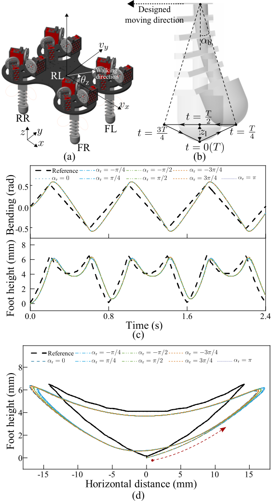
*Gait design. The legs move in diagonal pairs; each pair follows a periodic bending and foot-height pattern, and the foot traces a closed loop.*

The **state** is what the real robot can sense: body orientation (roll, pitch, yaw), velocity along three axes, normalized foot contact forces, and the previous action (to give the policy a memory of the hardware latency).

### The reward

The reward asks the robot to hold a reference forward speed $v_{ref}$ and discourages behaviours that make a gait bad:

- a **speed term** that peaks at $v_{ref}$ (shaped by $\epsilon_2=-1/v_{ref}$ so the maximum is one) and is negative for backward motion;
- a penalty on **action acceleration**, estimated by the finite difference $\ddot a_t\approx(a_t+a_{t-2}-2a_{t-1})/T_s^2$, which keeps motor commands smooth;
- penalties on **excessive bending** and on a leg pair **bending the same way over a horizon** of 16 steps, which would tip the robot;
- weights $[\epsilon_1,\dots,\epsilon_5]=[5,-1/v_{ref},0.25,10,3]$.

### Soft Actor-Critic

SAC maximizes return plus a policy-entropy bonus, $\pi^\ast=\arg\max_\pi\mathbb E_\pi\big[\sum_t r(s_t,a_t)+\alpha\,\mathcal H(\pi(\cdot|s_t))\big]$, which gives sample-efficient, stable training with continuous actions. Settings: learning rates 0.002 (critic) and 0.001 (actor and temperature), discount factor 0.96 for 50-step episodes, target entropy $-4$ (minus the action dimension), batch size 4,096, replay buffer 16,384, policy updated every 3 steps, control period $T_s=0.05$ s. Episodes end if roll or pitch exceeds 0.15 rad or a bending angle exceeds $\pi/3$.

## What a good gait is: footfalls, stability, and ZMP

The reward asks for speed, smoothness and no tipping, but behind it is the older vocabulary of legged locomotion, which is worth stating precisely because it explains what the robot can and cannot do.

**Gait vocabulary.** A foot is in **stance** (on the ground) or **swing** (in the air). The **duty factor** $\beta=t_{stance}/T$ is the fraction of the stride period $T$ that a foot spends on the ground, and the **phase** of a leg is the time of its touchdown as a fraction of $T$. The main four-legged gaits differ in the order and overlap of footfalls (for the animations and footfall diagrams, see the animators' reference [Quadrupeds: gaits](https://www.animatornotebook.com/learn/quadrupeds-gaits)):

| Gait | Footfall pattern | Beats | Supports |
| --- | --- | --- | --- |
| Walk | back left, front left, back right, front right (lateral sequence) | 4 | two to three feet on the ground at all times: statically stable |
| Trot | diagonal pairs together: back right with front left, then back left with front right | 2 | two feet at a time (the diagonal line), dynamically stable |
| Pace | same-side pairs together | 2 | two feet at a time (the side line), poor lateral balance |
| Canter | three beats, one lead leg | 3 | a suspension phase with all feet off the ground |
| Gallop | four beats, longer suspension | 4 | suspension grows with speed |

**Static and dynamic stability.** The **support polygon** is the convex hull of the feet on the ground. A gait is *statically* stable if the centre of mass projects inside that polygon at every instant, which a walk can satisfy (three feet make a triangle). With only two feet down the polygon collapses to a line, so a trot is balanced *dynamically*: it relies on motion and on the inertia of the body.

**Zero Moment Point.** The ZMP is the point on the ground about which the horizontal moments of gravity and inertial forces sum to zero. For a body of mass concentrated at height $z_c$ on flat ground, neglecting angular momentum,

$$
x_{ZMP}=x_c-\frac{z_c}{\ddot z_c+g}\,\ddot x_c ,
$$

and for a constant height this is the linear inverted pendulum result $x_{ZMP}=x_c-\frac{z_c}{g}\ddot x_c$. A gait is dynamically balanced when the ZMP stays inside the support polygon. On flat ground the ZMP coincides with the **centre of pressure** (CoP), which can be *measured* from the foot force sensors:

$$
\mathbf p_{CoP}=\frac{\sum_i F_i\,\mathbf p_i}{\sum_i F_i},
$$

where $F_i$ is the vertical force and $\mathbf p_i$ the position of foot $i$. SoftQ has a force sensor under each foot, and the normalised foot forces are part of the policy's observation, so the information needed for a CoP is present. **The thesis does not compute the ZMP explicitly**; balance is handled implicitly, through the contact-force observation, the termination limits (roll and pitch above 0.15 rad end an episode, which keeps the body close to an equilibrium), and the stability metric. I include the ZMP view because it makes the following gait analysis quantitative, and because adding a ZMP or CoP margin as a reward or constraint is a natural extension.

**What SoftQ's learned gait does, read from the footfall diagram.** The legs move as diagonal pairs, which makes the gait a trot. The learned pattern has a stride period of **0.25 s** (four steps per second), each foot is on the ground for about **0.15 s**, and the second diagonal pair lands about **0.10 s** after the first:

$$
\beta=\frac{0.15}{0.25}=0.6,\qquad \text{phase lag between pairs}=\frac{0.10}{0.25}=0.4 .
$$

An ideal trot has a phase lag of 0.5, so this is a trot with a duty factor above one half, hence **no flight phase**. The two pairs overlap for $0.15-0.10=0.05$ s per cycle: for 20% of the time all four feet are down (a quadrilateral support polygon), and for **80% of the time only one diagonal pair is down**, so the support polygon is the line between two feet and the ZMP has to stay near that line. The body therefore rolls about the diagonal, and the simulated roll and pitch stay within roughly ±0.02 rad in the validation run (Figure 4.2.4(d) of the thesis), well inside the 0.15 rad termination limit. A full walk (three feet down) is not available, because the robot's legs are coupled in diagonal pairs: this is the limitation noted under "Limitations".

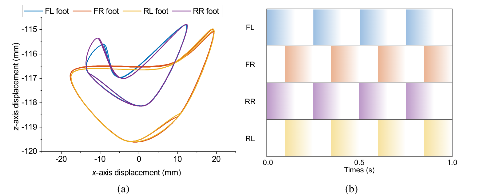
*The learned gait. Left: the four foot trajectories in the x–z plane over one cycle; the FL and RR feet trace one loop, the FR and RL feet another. Right: footfall pattern over one second; each pair repeats every 0.25 s and the pairs are offset by 0.1 s.*

## The pipeline

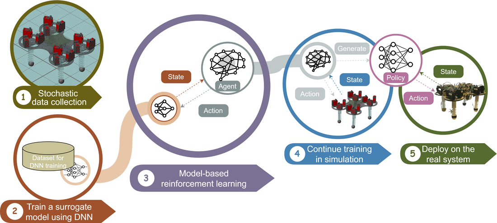
*The method in five steps: stochastic data collection, a neural-network surrogate model, MBRL inside the surrogate, post-training in the accurate simulation, then deployment.*

1. **Collect data** by driving the accurate Simulink/Simscape model of SoftQ with random actions. The model represents each flexible leg with a lumped-parameter chain of rigid disks and cores joined by spring-damper joints, with servo, spool, tendon, and ground-contact subsystems (friction coefficients 0.315 static and 0.30 dynamic).
2. **Train the surrogate**, a network that predicts the next state from the current state and action. The chosen architecture is a fully connected network (14 inputs, hidden layers of 64, 128, and 64 units with ReLU, and 10 outputs) trained with Adam on about 200 data sequences. A bidirectional LSTM was also tested; the fully connected network used data more efficiently and was more stable over long prediction horizons, so it was kept.
3. **Train the agent by MBRL**: SAC interacts with the surrogate instead of the slow simulator.
4. **Post-train** in the accurate simulator, starting from the converged policy, with an **expert trot** guiding the first second of each episode (a form of imitation) and a reward adjusted to the new dynamics.
5. **Deploy** on the physical robot.

The surrogate's restricted action range mattered. Mapped over the bending and compression ranges, the surrogate was most accurate for about $\alpha_b\approx0.6$ rad and $z_l\approx7$ mm; slightly wider ranges (about 0.63 rad and 8 mm) gave the agent more room to explore at the cost of some accuracy. This is the trade-off between simulation accuracy, learning efficiency, and long-horizon prediction accuracy that research question 2 asks about.

## Results at a glance

**Learning** (against model-free reinforcement learning, MFRL, in the same simulator and with the same reward):

| Metric | MBRL with post-training | Model-free RL | Expert trot |
| --- | --- | --- | --- |
| Episodes to converge (ICRA 2025) | about 60 | about 450 | not applicable |
| Episodes to converge (thesis, 2023) | about 200 | about 350, did not converge | not applicable |
| Training time | about 10.5 h | about 22.6 h | not applicable |
| Cost of transport | about 68 J/kg/m | about 501 J/kg/m | about 81 J/kg/m |
| Stability score | about 0.65 | about 0.03 | not reported here |
| Simulated speed | up to 0.36 m/s (mean 0.26 m/s) | lower | not reported here |

The 2023 thesis and the 2025 paper use different training configurations, so the episode counts differ; the direction and the ranking agree. **Cost of transport** is $COT=E/(m\,d)$, energy used per unit mass per distance travelled; lower is better.

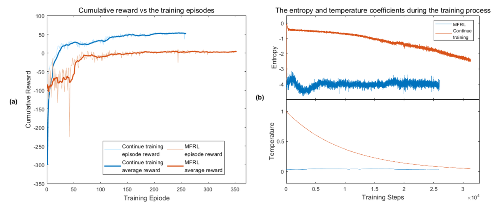
*Thesis training curves for post-trained MBRL against model-free RL: cumulative reward (left) and the entropy and temperature coefficients (right).*

**Statistics.** Each method was trained three times at each of three reference speeds (0.2, 0.3, and 0.5 m/s), and an **ANCOVA** with reference speed as covariate was run on 18 trained agents:

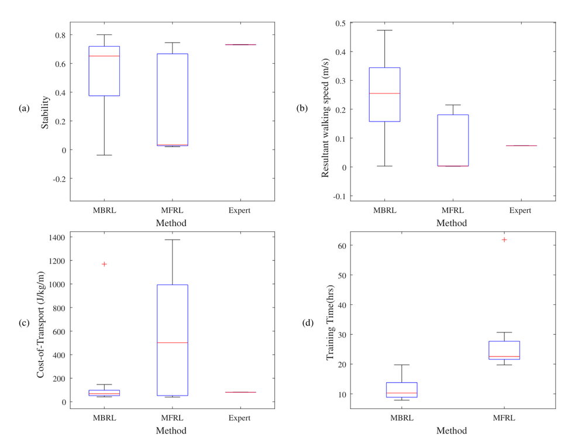
*Box plots over the three reference speeds: stability, resultant walking speed, cost of transport, and training time, for MBRL with post-training, MFRL, and the expert gait.*

| Metric | Effect of method (MBRL vs MFRL) | Effect of $v_{ref}$ | Interaction |
| --- | --- | --- | --- |
| Stability | $p=0.031$ | $p=0.038$ | $p=0.020$ |
| Resultant walking speed | $p=0.007$ | $p=0.81$ | $p=0.053$ |
| Cost of transport | $p=0.036$ | $p=0.054$ | $p=0.090$ |
| Learning efficiency | $p=0.003$ | $p=0.33$ | $p=0.25$ |

The learning method has a significant effect on all four metrics at the 5% level, while the reference speed matters for stability but not for speed or learning efficiency. Three runs per cell is a small sample, and the cost of transport has a heavy tail for model-free RL (a few very bad runs), so the p-values are a guide to the direction, not a precise statement.

## RL as a trajectory optimiser, and learning on both sides

**The policy is a foot-trajectory optimiser inside an expert-designed structure.** At every 50 ms step the policy outputs four numbers, the bending angle and compression length of each diagonal pair. Through the inverse kinematics these set where each foot is. A walking gait is therefore a *closed curve of foot positions repeated at a rhythm*, and what the reinforcement learner discovers is the shape of that curve and the timing between the pairs. From the plot above, the FR and RL feet move through a loop about 36 mm wide and 5 mm high, and the FL and RR feet through a smaller one, about 25 mm wide and 3 mm high. This is trajectory optimisation done by trial, with the reward standing in for a cost function that nobody wrote by hand: **expert knowledge sets the structure** (which variables exist, their ranges, the kinematics, the diagonal pairing, the termination limits) and **learning optimises within it**, finding a timing and a shape that are efficient on this particular soft body.

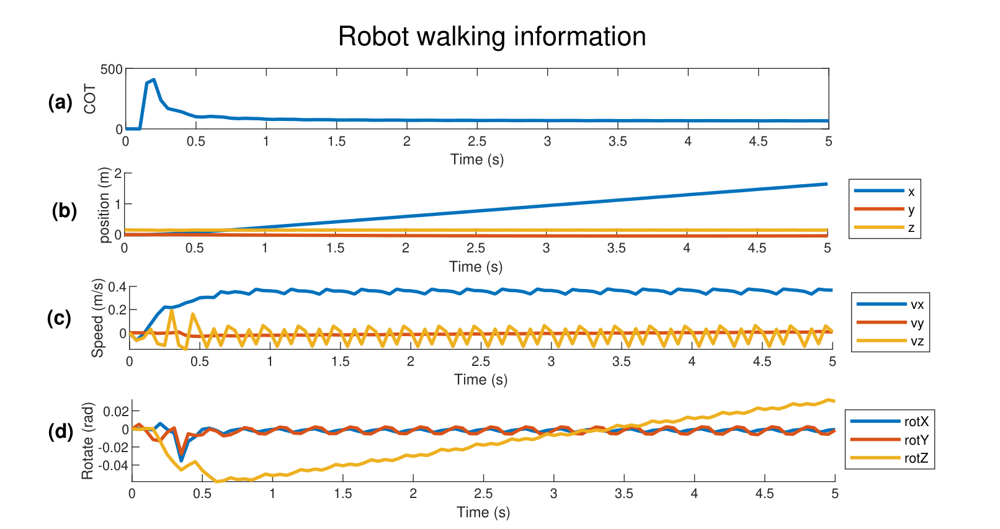
*Validation of the learned policy in simulation. (a) cost of transport, high at the start while the body accelerates and then low; (b) distance along the three axes, a steady 1.8 m in 5 s; (c) speeds, with the forward speed near 0.36 m/s and a visible stepping ripple; (d) orientation, with roll and pitch within about ±0.02 rad and a slow yaw drift.*

**We learned about the system while it learned.** The training runs and the learned gait were also experiments on the robot, and several things were found that nobody put in:

- **An asymmetry in the hardware.** The FL and RR pair swings through a smaller area than the FR and RL pair, and the yaw drifts slowly in one direction. The explanation in the thesis is that the learner is correcting yaw error caused by a slightly uneven mass distribution favouring one side. This is also why the real robot turned and corrected its heading in the same way it did in simulation.
- **The useful operating range of the legs.** The surrogate's accuracy map over bending and compression showed that about 0.6 rad of bending and 7 mm of compression is where the model is most reliable, and that slightly wider limits give the learner room to explore: the action range was *discovered*, not assumed.
- **A natural stepping rhythm.** The agent settled on four steps per second with diagonal pairs offset by 0.1 s, a contact time of 0.15 s and no flight phase, which suits a robot whose legs spend tens of milliseconds compressing and recovering.
- **A cost of starting.** The cost of transport spikes at the start because the body has to be accelerated, then falls to about 73 J/kg/m.

**The engineer is trained too: reward design is a learning loop.** A reward function is a specification written before the behaviour exists, and the agent shows what the specification really means by exploiting it. The reward and its surroundings here record several rounds of that iteration; the clearest case is the bending penalty, which the thesis reports was insufficient alone and had to be extended. The terms and settings, in order of the thesis:

1. A **speed term** peaking at the reference speed, with a sharper decay for low reference speeds ($\epsilon_2=-1/v_{ref}$); low reference speeds were the ones where training failed more often.
2. An **action-acceleration penalty** ($\epsilon_3=0.25$), to discourage abrupt motor commands.
3. A **bending penalty** ($\epsilon_4=10$), which was *not enough on its own*, so a second term ($\epsilon_5=3$) penalising a leg pair that keeps bending the same way over a 16-step horizon was added.
4. **Termination limits** (roll and pitch under 0.15 rad, bending under $\pi/3$), added so that failed episodes end early instead of corrupting the data.
5. **Observation noise** at levels taken from the sensor calibration ($\sigma^2=0.002$ for angle and velocity, $0.005$ for force), added to widen the robustness margin before the real robot.
6. A **stability metric** for evaluation, $0.2\,\Delta t-\max|\dot\theta_z|-\max|v_y|$, used to compare methods in a way the reward alone did not.

Each of these changed what the robot did, and each also changed what the engineers understood about the task. That feedback runs in both directions: **the reward trains the policy, and the policy's behaviour trains the person who writes the reward.** In my experience on this project, time spent on reward design and on the structure around the learner mattered at least as much as the choice of learning algorithm, which is consistent with a model-based method with expert structure converging in far fewer episodes than a model-free one, though the thesis does not isolate that factor.

## From simulation to hardware


*The system architecture, as drawn in the paper. Purple: the electrical firmware (Raspberry Pi with the IMU and the five time-of-flight sensors on I2C, an STM32 reading the foot force sensors and talking to the Pi over UART). Blue: the actuator firmware (12 servo motors, three per leg, with PD controllers). Brown: the controller in Simulink, run in external mode over Wi-Fi: state estimate, control policy, and kinematics conversion. The loop closes through the robot: contact forces, distances to the surroundings, and quaternions with linear accelerations come back and become the observation.*

- **Hardware stack:** servo motors with position loops, an STM32 microcontroller for actuation and force sensing, and a Raspberry Pi for sensing and communication; the learned policy runs in Simulink in external mode with a 50 ms control step. The Python program on the Pi is described in detail under "What SoftQ.py is for".
- **State estimation:** quaternions from the IMU become Euler angles, and a **Kalman filter** fuses linear acceleration with time-of-flight distance to estimate forward velocity (see "State estimation: a model corrected by reality"). Foot contact forces are binarized to be robust to sensor noise.
- **Real-time structure:** the Pi runs periodic threads at about 20 Hz (serial exchange with the STM32 and sensor upload) and a faster receive poll, and the STM32 acts only when a command frame arrives; the thesis describes the Simulink link as UDP, the final code as a TCP stream.

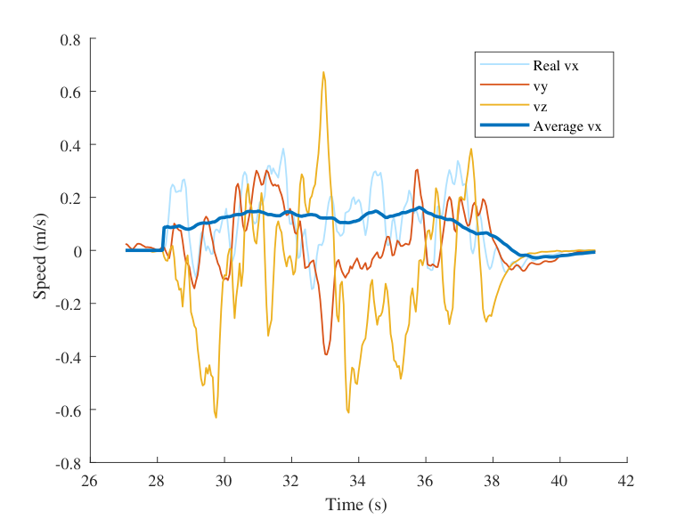
*Real-robot test: measured speed along three axes while the robot walks, with the averaged forward speed.*

The directly learned policy for $v_{ref}=0.3$ m/s walked **1.5 m in about 10 s** toward a divider and stopped near it, at an average speed of **about 0.15 m/s**. That is half the simulated target but about three times the roughly 0.05 m/s of the previous model-free baseline on the same hardware. The gap to simulation is the **reality gap**: imperfect actuator, sensor, and foot-ground contact models. The robot also turned and corrected its heading in the same way it did in simulation, which suggests that the learned behaviour transferred rather than merely survived.

**Live demos (clips from the field-test and simulation videos).** The same learned gait in simulation and on the real robot; the sensor lead and cables are visible in the real clips.

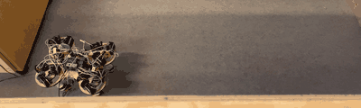
*Real robot, top view: the policy walks across the test arena.*

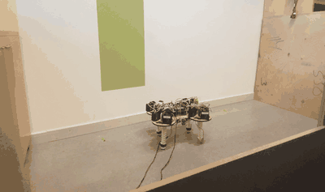
*Real robot, side view: the diagonal leg pairs alternate and the soft legs compress and spring back.*

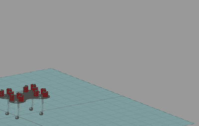
*The Simscape model walking at the same reference speed (0.3 m/s).*

## Limitations and what is next

- **The sim-to-real gap is real.** Real speed is half the simulated target. Better actuator and contact models, or online adaptation, would close it.
- **Coupled legs limit the gaits.** The robot's leg pairs move together, so the approach is tested on a restricted action space; independent legs would be a harder test.
- **Small statistical samples.** Three training runs per condition support direction, not tight confidence intervals.
- **Next steps** in the paper and thesis: new soft actuators and sensors, adaptation to different terrains, online learning, and robustness and fault tolerance.

The part I value most is the system view. The reward is a specification, so most of the work is deciding what "walking well" means; the surrogate's long-horizon error limits how far a model-based method can trust itself; and the quality of the state estimate, from cheap sensors and a Kalman filter, caps what any policy can do.

## The engineering behind the results

The learning algorithm is the part that fits in a paper. Most of the thesis work was the system that lets a learned policy run on a real robot at 20 Hz without damaging it. The repository records that effort: **67 commits from March to November 2023**, a middle-layer package of about **3,200 lines of Python** across nine files, an STM32 firmware project (about 1,100 lines in `main.c`, mostly generated initialisation code, plus servo and ADC helper modules), data-collection and training scripts in MATLAB and Python, and Simulink models for simulation, training, joystick teleoperation, and real-time deployment.

### The software stack

```
  Simulink (PC, or on the Pi in external mode): policy      <-- learning and decision layer, 20 Hz
        ^  | TCP: 60 B of floats up (ToF x5, Euler x3, acc x3, FSR x4), 12 B of motor angles down
        |  v
  Raspberry Pi: Python middle layer `SoftQ`                  <-- sensing, time base, protocol, safety
        ^  | I2C: 5 x VL53L1X ToF (addresses 0x21-0x25 via XSHUT lines), BNO055 IMU
        |  v UART 115200: 18 B command frame down, 19 B sensor frame up
  STM32 G431KB firmware (HAL)                                <-- hard real-time actuation
        |  12 x servo PWM (position loop inside each servo)   4 x FSR via ADC + DMA   power-relay GPIO
        v
  SoftQ: 4 tendon-driven soft legs, 12 servos, 4 foot force sensors, IMU, ToF
```

Each layer has one job, and each interface is a small, fixed-size message. That makes every layer testable alone (the policy can run against a recorded stream; the firmware can be driven from a terminal), which turned out to matter more than any single algorithm choice.

### What SoftQ.py is for

`SoftQ.py` is the program on the Raspberry Pi. Without it there are three programs that cannot talk to each other: a Simulink policy that thinks in floats and 20 Hz steps, a microcontroller that thinks in bytes and servo pulses, and a handful of sensors that each have their own bus and timing. `SoftQ.py` is the **runtime that makes them one system**. It does five jobs:

1. **Acquire**: read five time-of-flight sensors and the IMU over I2C, and foot forces from the STM32.
2. **Translate**: convert quaternions to Euler angles, pack floats for Simulink, and pack bytes for the STM32.
3. **Schedule**: run four periodic threads at different rates and keep shared data consistent.
4. **Protect**: if commands stop or the network drops, move to a neutral pose and cut motor power.
5. **Recover**: reconnect, resynchronise frames, and restore sensor calibration after a restart.

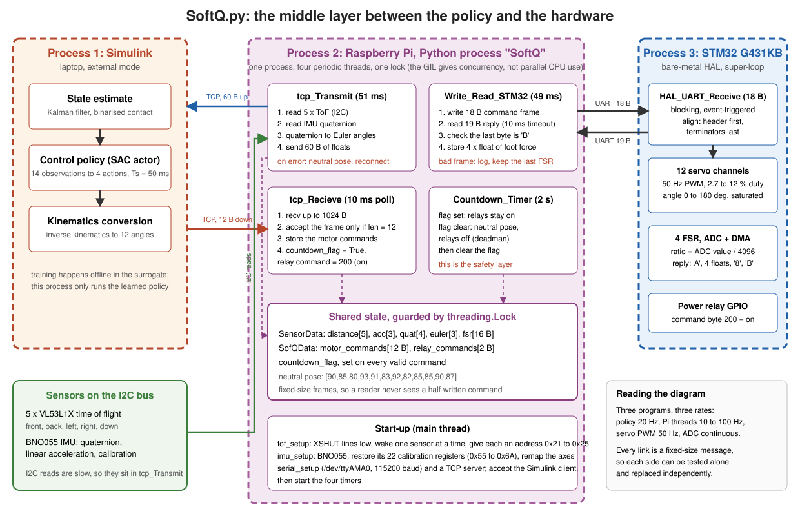
*The runtime. Process 1 is Simulink on the laptop; process 2 is the Python program on the Raspberry Pi, with four periodic threads (sensor upload every 51 ms, command receive polled every 10 ms, serial exchange with the STM32 every 49 ms, and a 2 s deadman) around one lock-protected block of shared state; process 3 is the STM32 firmware. Every link is a fixed-size message.*

**How data and control move through it.** Sensors are read *inside* the upload thread, so the latency of the slow I2C reads delays only the upload, not the safety logic. Commands arrive as a 12-byte frame; only a frame of exactly that length is accepted, which makes a half-received frame harmless. A received command sets a flag, and the 2 s countdown thread checks the flag: if it is set the relays stay on, if it is clear the robot is put in a neutral pose and the relays are cut. That makes the **deadman independent of the network and of the policy**. The Pi and the STM32 are separate processors, and in the Pi the threads run concurrently under the Python interpreter lock, which is adequate here because the threads spend their time waiting on I/O (sockets, serial, I2C) rather than computing.

The main cost of this design is that the Python scheduling is not hard real-time: timer jitter of several milliseconds is possible, so anything with a hard deadline (servo pulse generation, force sampling) is on the STM32 and only the 20 Hz exchange is on the Pi.

### The middle layer: from scripts to a runtime

The middle layer is the code that sits between a learning stack and the hardware. It is the least visible part of a robotics project and, in practice, much of what robotics companies actually build: sensor drivers, time bases, message framing, state estimation, watchdogs, logging, and the glue that lets researchers swap the policy without touching the hardware. I restructured it in stages, visible in the commit history:

| Stage (commit date) | Form | What changed and why |
| --- | --- | --- |
| Inherited approach | `main.py`: one loop reading and writing memory-mapped binary files shared with Simulink | worked as a first link, but a file is a poor interface: no framing, no timing, no recovery |
| 26 May | `server_test.py`: procedural socket and serial scripts | first end-to-end data path to Simulink |
| 30 May | `SoftQ.py`: a single `SoftQ` class with a lock and logging | one object owns the devices and the state; error handling in one place |
| 5 to 9 July | `SoftQ_optimized.py`: dataclasses for sensor and command data, documented methods, concise STM32 thread | explicit data types, fixed frame layouts, and handling of unexpected serial frames |
| 10 Oct | `SoftQ_CPG_optimized.py`: TCP server with reconnection, central-pattern-generator support | the robot keeps running safely when the link to the policy drops |

The design choices in the final version, and why:

- **Independent periodic tasks.** Four timers run the system: serial exchange with the STM32 every 49 ms, sensor upload to Simulink every 51 ms (both close to the 50 ms control step), command receive polling every 10 ms, and a 2 s countdown watchdog. A lock serialises access to the serial port and the socket.
- **A deadman.** If no valid command arrives within the countdown, the middle layer drives all twelve servos to a stored neutral pose and switches the power relays off. If the TCP connection fails, it does the same and then waits for a new connection. **This was the safety layer for a robot that a learning algorithm was commanding**, and it is the part I would defend most firmly in a safety review.
- **Fixed-size framing.** The STM32 command frame is 18 bytes (header `S`, 12 motor bytes, 2 relay bytes, three terminator bytes) and the reply is 19 bytes (header `A`, four floats of normalized foot force, a check byte, terminator `B`). The firmware does not assume that frames arrive aligned: it searches the circular receive buffer for the rotation that has the header first and the terminators last, which recovers from a slipped byte.
- **Multi-sensor bring-up.** Five identical ToF sensors share one I2C bus. The middle layer pulls their XSHUT lines low, wakes them one at a time, and assigns each a unique address (0x21 to 0x25), which is the standard way to use several same-address sensors.
- **Calibration that survives a restart.** The BNO055 IMU's 22 calibration registers (0x55 to 0x6A) are written back at start-up, the axes are remapped to the robot frame, and the Euler angles are computed from the quaternion.
- **Timing budget.** One serial exchange (18 plus 19 bytes) takes about 3.2 ms on the wire at 115200 baud, about 6% of the 50 ms control period, and the five ToF reads add at least 5 ms (a 1 ms pause after each) plus the sensors' ranging time, so each cycle has a known fixed cost before the policy acts.

A review of the code today finds things I would harden, and they are worth listing because they are typical of research-grade robotics code:

1. The error branches in the STM32 exchange read `self.data_from_stm32`, an attribute that is never assigned (the data is held in a local variable), so a malformed frame raises an `AttributeError` that the surrounding `except ValueError` does not catch.
2. Several `try/except` blocks catch everything and print a short message, which hides the cause of a fault.
3. The ToF read sits inside the Simulink-transmit timer, so sensor latency directly delays the upload; a dedicated reader thread with a queue would decouple them.
4. In the IMU set-up loop the "give up" test (`i == 100`) can never be true because `range(100)` stops at 99.
5. The STM32 receive call blocks with no timeout and the firmware has no on-chip watchdog, so safety rests on the host-side deadman alone; an independent watchdog and a receive timeout on the MCU would make the actuator layer safe by itself.

The STM32 servo and ADC helper libraries come from a 2020 course library (the file headers credit their author); the application loop, framing, relay logic, and integration are ours. The Bayesian neural-network ensemble scripts in the repository are by the supervisor, Kaige Tan.

### State estimation: a model corrected by reality

The policy needs the forward velocity, and no sensor on the robot measures it. The IMU measures **acceleration**, which must be integrated twice to give position and once to give velocity; the time-of-flight sensors measure **distance to the surroundings**, which must be differentiated to give velocity. Each alone is a poor velocity sensor, in opposite ways:

- **Differentiating distance amplifies noise.** With a ToF noise of $\sigma_d$ and a step $T_s$, the difference of two samples has a velocity noise of $\sqrt2\,\sigma_d/T_s$. At $T_s=0.05$ s and $\sigma_d=5$ mm that is 0.14 m/s, about the size of the walking speed itself.
- **Integrating acceleration drifts.** A constant accelerometer bias $b$ gives a velocity error $bt$, which reaches 0.3 m/s after 10 s for $b=0.03$ m/s², and body vibration from the steps adds noise on top.

A Kalman filter combines a **model** (physics: acceleration integrates to velocity and position) with **reality** (the ToF measurement). The prediction is a smooth guess that slowly drifts; the measurement is unbiased but noisy; the filter weights them by their uncertainty.

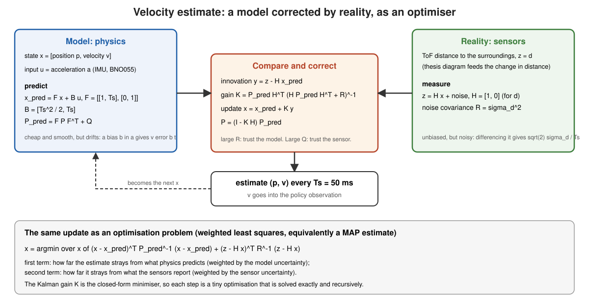
*The velocity estimator. The model (left) predicts position and velocity from the IMU acceleration; the sensors (right) provide the distance; the correction step (centre) forms the innovation and updates the state with the Kalman gain, which is the exact solution of the weighted least-squares problem at the bottom.*

**The optimiser view.** The update is the minimiser of

$$
\hat x_k=\arg\min_x\ \lVert x-\hat x_{k|k-1}\rVert^2_{P_{k|k-1}^{-1}}+\lVert z_k-Hx\rVert^2_{R^{-1}} ,
$$

a weighted least-squares fit between *what physics predicts* and *what the sensor reports*, with the weights set by how much each is trusted. The Kalman gain $K_k=P_{k|k-1}H^\top(HP_{k|k-1}H^\top+R)^{-1}$ is the closed-form minimiser, so the filter is a recursive optimiser solved exactly at each step. The tuning knobs $Q$ (model uncertainty) and $R$ (sensor uncertainty) move the trust between model and reality, and in a scalar example $K=P/(P+R)$: a very noisy sensor ($R\gg P$) gives $K\approx0$ and the filter follows the model, while a very accurate sensor gives $K\approx1$ and the filter follows the sensor.

**A numerical illustration.** To check that this works for the right reasons, I simulated the estimator with illustrative parameters (these are assumptions, not the robot's calibration): a true velocity of $0.15+0.08\sin(2\pi t)$ m/s, $T_s=0.05$ s, ToF noise 3 to 8 mm, accelerometer noise 0.3 to 0.5 m/s², bias 0.03 to 0.05 m/s², 20 runs of 20 s each. Velocity RMSE in m/s:

| ToF noise / accel noise / bias | Differentiate ToF | Integrate IMU | Kalman filter |
| --- | --- | --- | --- |
| 3 mm / 0.3 m/s² / 0.03 m/s² | 0.084 | 0.360 | 0.024 |
| 5 mm / 0.3 m/s² / 0.03 m/s² | 0.140 | 0.360 | 0.028 |
| 8 mm / 0.5 m/s² / 0.05 m/s² | 0.224 | 0.593 | 0.045 |

The differentiation errors match the formula $\sqrt2\sigma_d/T_s$ (0.085, 0.141, 0.226), and in this idealised setting the filter is about three to five times better than the better single source. **The real robot is a harder case, and the thesis figure below should be read honestly.** The estimate (yellow) reliably separates standing (near zero) from walking, and the raw ToF velocity (red) drifts to about −0.8 m/s, so the fusion clearly helps against that source. But during walking the estimate is noisy, with spikes of several tenths of a metre per second against a ground-truth ripple of about 0.1 m/s, and it sits above the ground truth on average; the thesis itself notes "some inconsistencies" that it attributes to the reality gap, ground conditions, and the environment. The filter rests on a *linear* constant-acceleration model, and slipping feet, body rotation, ToF geometry, and non-white noise are not in it. That matters for learning: training injected observation noise with variance 0.002 on velocity (a standard deviation of about 0.045 m/s), which looks smaller than the noise visible in this real estimate, so the velocity the policy sees on hardware is noisier than the velocity it trained on. That is one concrete, measurable part of the reality gap, and a better estimator or matched training noise are the obvious next steps.

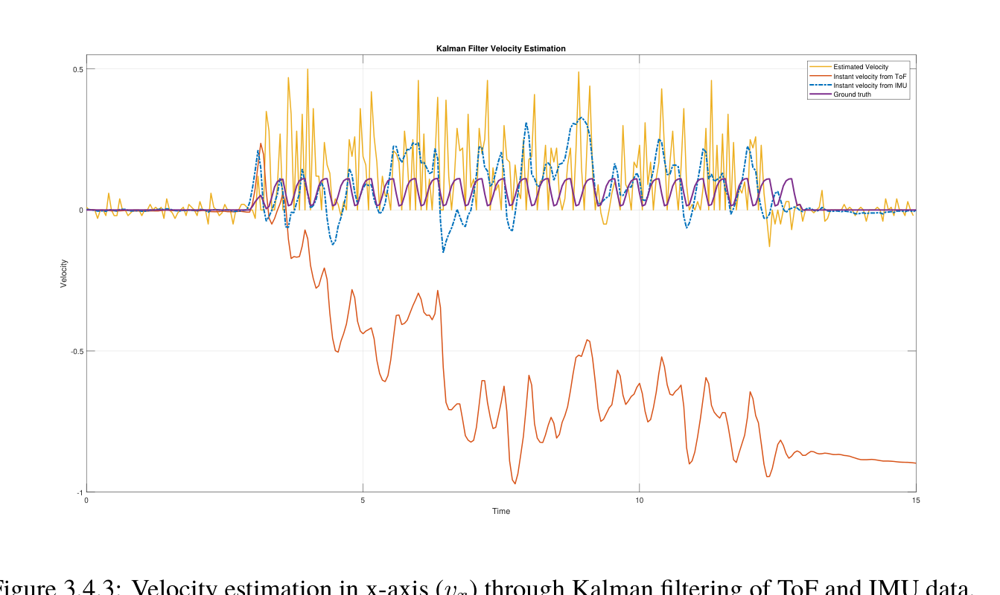
*Thesis Figure 3.4.3: forward velocity on the real robot over 15 s. Legend: estimated velocity (yellow), instant velocity from ToF (red), instant velocity from the IMU (blue, dashed), and ground truth (purple). The estimate captures when walking starts and stops but is noisy in between; the ToF-derived velocity drifts.*


*How the two sensors enter the filter: acceleration drives the prediction, the distance change drives the update.*

### Several loops at different rates

The system is not one control loop but a hierarchy of loops, each at the rate that suits its physics, joined by fixed-size messages. Reading from the fastest to the slowest:

| Time scale | Loop | Where | Note |
| --- | --- | --- | --- |
| continuous | force-sensor sampling by ADC with DMA | STM32 | no CPU involvement |
| servo's own rate; command frame every 20 ms | servo position control, 50 Hz PWM command | servo and STM32 timer | PWM duty 2.7 to 12 % maps 0 to 180 degrees |
| about 10 ms | command receive polling | Pi (thread) | the thesis text gives 50 Hz |
| 49 and 51 ms | serial exchange with the STM32, sensor upload | Pi (threads) | about 20 Hz |
| 50 ms | state estimate, policy, kinematics conversion | Simulink | control step $T_s$ |
| 250 ms | gait cycle (four steps per second) | emergent | five control steps per cycle |
| 2 s | deadman countdown | Pi (thread) | safety, 0.5 Hz |
| 2.5 s | one training episode (50 steps) | simulation | |
| hours | training (about 10 hours for MBRL) | offline | |

Two consequences follow. **The policy does not control individual motors; it modulates a rhythm.** At 20 Hz with a 4 Hz gait there are five decisions per step, enough to shape the foot trajectory and rebalance, but too slow for reflexes, which is why the fast, hard-real-time work stays below it. And **the interfaces between rates are where problems hide**: a command arriving late, a stale sensor sample, or a mismatched frame length all appear at the boundaries, which is why every boundary here has a fixed message size, a timeout, and a safe default.

### What else was built along the way

- **Data pipeline.** Random-action data collection from the Simulink model into `.mat` files, normalization, and train and validation splits; the surrogate comparison (a fully connected network against a bidirectional LSTM), dataset-size studies, and delta-state prediction variants.
- **Classical gait generator.** A Simulink central pattern generator of four coupled Hopf oscillators, with explicit phase offsets for a trot and gains that map the oscillator outputs to the three leg coordinates. It gives a hand-designed reference against which a learned gait can be judged.
- **Optimisation experiments.** Bayesian optimisation scaffolding in MATLAB for tuning gait parameters, and probabilistic-dynamics (ensemble) models for uncertainty.
- **Evaluation.** Controlled comparison scripts, the ANCOVA tests, and the field test with video, covering both the simulated and real robot.

## A hybrid of classical control and learning

The controller is not a neural network driving motors. It is a layered system in which each layer uses the tool that suits it:

| Layer | Method | Rate | Why this tool |
| --- | --- | --- | --- |
| Servo position loop | PD controllers in the actuator firmware and the servo, driven by a 50 Hz PWM command | faster than the command rate | solved problem; a learner adds nothing here |
| Leg kinematics | analytic inverse kinematics | per command | exact geometry, cheap, interpretable |
| Gait structure | diagonal-pair parametrization (and an optional oscillator-based pattern generator) | per step | injects prior knowledge; cuts the action space from 12 to 4 |
| State estimation | Kalman filter on IMU and ToF, binarized contact | 20 Hz | a classical estimator gives velocity that no single sensor provides |
| Gait policy | learned (SAC) | 20 Hz | contact and soft deformation are hard to model |
| Safety | termination limits in training, bounded action range, deadman on the host | continuous | guarantees that do not depend on the network |

The division follows a simple principle: **use learning for what is hard to model, and keep classical methods where they offer guarantees or exactness.** Three consequences are worth stating. The learned policy has bounded authority, because its output is four numbers inside a fixed range that are mapped through exact kinematics, so a bad action produces a bad pose, not an unsafe motor command. The classical layers make the learning problem smaller and better conditioned, which is a large part of why it converged in tens of episodes. And the system is diagnosable: when it fails, one can ask which layer failed. The cost is that the whole is only as good as its weakest assumption, and I have not proved stability for the combined system; the guarantees are the engineering ones listed above, not a formal result.

## Why the method still applies

The pipeline in this thesis (collect data, learn a dynamics model, train a policy inside it, refine in a high-fidelity simulator, deploy on hardware) has become the standard shape of robot learning. The following mapping is my own assessment of how the thesis components relate to current practice; I have not run these comparisons.

| Thesis component | Current counterpart | What carries over | What would change today |
| --- | --- | --- | --- |
| Learned surrogate of the robot | learned dynamics and world models (model-based RL, Dreamer-style agents) | train the policy on cheap imagined rollouts and reserve expensive simulation or hardware for correction | use ensembles or latent models to quantify uncertainty and limit rollout length |
| SAC in the surrogate | SAC and PPO policies in massively parallel simulators | entropy-regularised exploration, sample efficiency | thousands of parallel environments reduce the value of a surrogate where a fast simulator exists |
| Post-training in the accurate simulator | fine-tuning, domain randomization, residual learning | start from a good policy and adapt under the real dynamics | randomize physical parameters during training to widen the robustness margin |
| Reality gap measured on the real robot | actuator networks and system identification | measure the gap, then model it (for example, a learned actuator model) | fit the actuator and contact models to hardware data before training |
| Action parametrization and inverse kinematics | structured action spaces, CPG-based or residual policies | a good prior shrinks the problem | the same idea reappears as motion primitives and skill libraries |
| Middle layer with deadman and typed messages | real-time middleware and hardware abstraction layers | sensors, time, safety, and logging as a separate, testable layer | use a standard framework with deterministic scheduling and logging |

The same structure extends to systems with **language and vision models**. In current vision-language-action systems, a large pretrained model proposes goals or actions from images and text at a low rate, a learned or classical low-level controller turns them into motion at a high rate, and safety logic bounds the result. Replacing the three-layer shape "policy, kinematics, servo" by "language model, skill policy, controller" keeps every interface problem this thesis dealt with: fixed message formats between layers, explicit rates, bounded authority for the learned component, a deadman, and a way to measure the gap between a simulated and a real deployment. The new part is that the high-level component is now general, but the lesson from the hybrid design is the same: the interfaces, the bounds, and the safety layer decide whether a learned component can be trusted on hardware.

**References for this section:** T. Haarnoja et al., "Soft Actor-Critic" (ICML 2018); K. Chua et al., "Deep Reinforcement Learning in a Handful of Trials using Probabilistic Dynamics Models" (NeurIPS 2018); M. Janner et al., "When to Trust Your Model: Model-Based Policy Optimization" (NeurIPS 2019); D. Hafner et al., "Mastering Diverse Domains through World Models" (2023); J. Hwangbo et al., "Learning agile and dynamic motor skills for legged robots" (Science Robotics, 2019); J. Tobin et al., "Domain Randomization for Transferring Deep Neural Networks from Simulation to the Real World" (IROS 2017); A. Brohan et al., "RT-2: Vision-Language-Action Models Transfer Web Knowledge to Robotic Control" (2023).

## Citation

```bibtex
@inproceedings{niu2025optimal,
  title     = {Optimal Gait Control for a Tendon-driven Soft Quadruped Robot by Model-based Reinforcement Learning},
  author    = {Niu, Xuezhi and Tan, Kaige and G{\"u}rd{\"u}r Broo, Didem and Feng, Lei},
  booktitle = {IEEE International Conference on Robotics and Automation (ICRA)},
  year      = {2025},
  publisher = {IEEE}
}
```

Please check the page and DOI in the proceedings before citing; this entry has the fields known to me.
