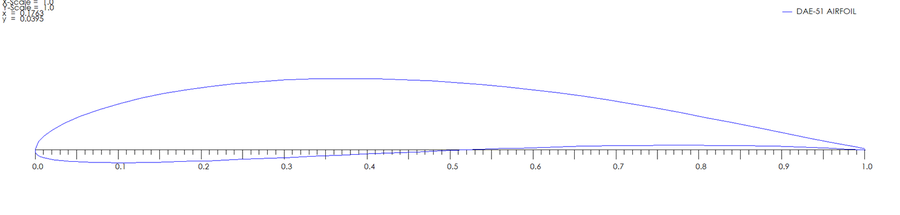
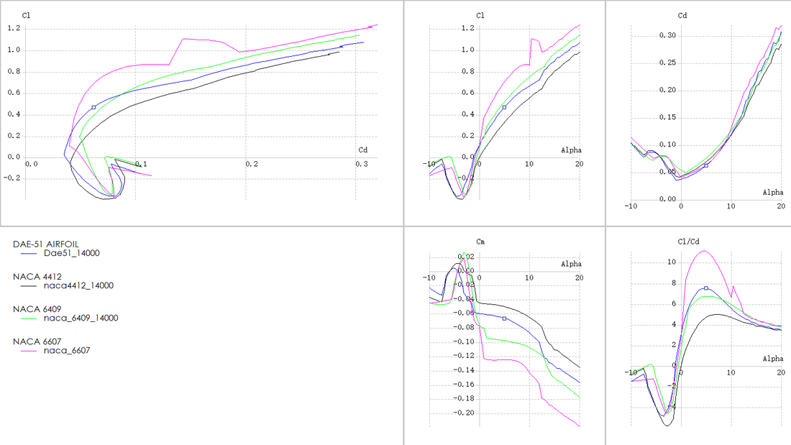
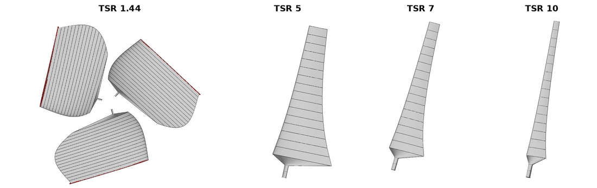
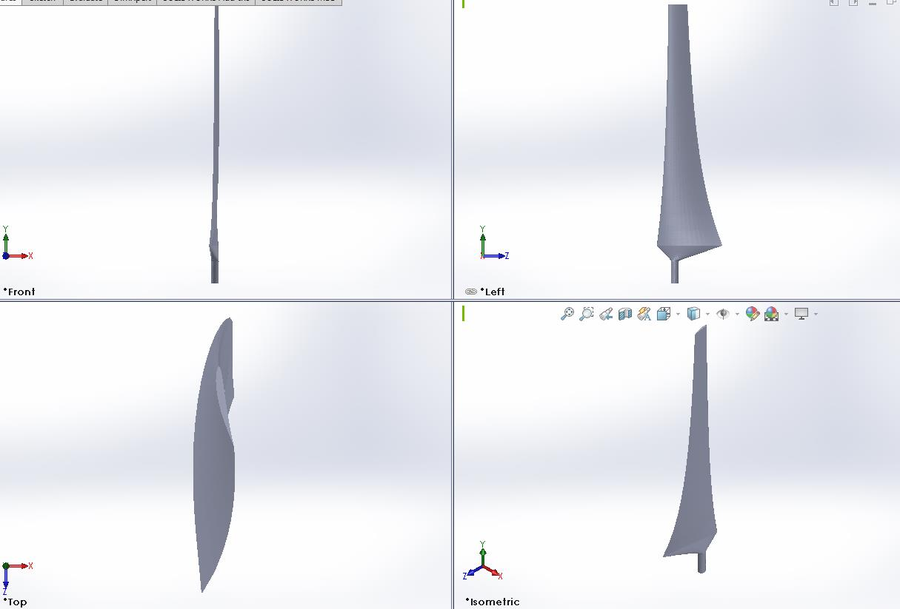
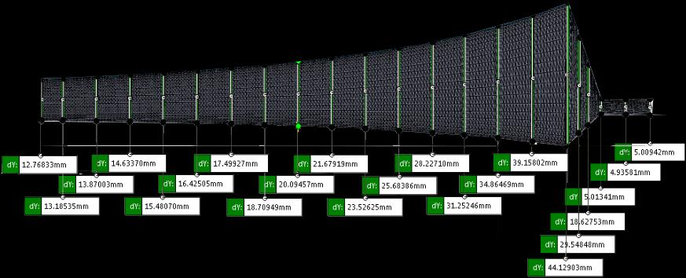

# **Small Wind Turbine Blade Design — from "Most Energy" to "Easy to Start"**

<i class="fas fa-university"></i> City University of Hong Kong, MNE3010 Mechanical Design, group project (team of five), Semester B 2020/21, report submitted 22 April 2021

The brief handed every group the same wind-turbine kit and asked for one thing: **a new set of blades, 3D printed, that harvests as much wind energy as possible.** This page tells the design story honestly, including the wrong turn, and uses the project to work through the aerodynamics that actually decide a small blade: lift and circulation, low Reynolds number, finite-span effects, momentum theory and the Betz limit, blade element theory, the Schmitz optimum, and why a blade that is best at running can be worst at starting.

## 1. The brief and how it is scored

- **Platform:** the same wind-turbine kit for every group; students design and 3D print a new blade set (PLA, from the library printing service, was the only available material) and may modify the kit if needed.
- **Blade assessment (50% of the project):**
  - **Total energy harnessed (30%).** Each group's energy is divided by the class total and multiplied by a common pool of marks, so the mark is $\text{Mark}_i=\text{Pool}\cdot W_i/W_{total}$. It is a competition: more energy than the rest of the class means more than 30%.
  - **Energy per mass (20%).** Energy divided by blade-set mass, in mJ/g, ranked into four tiers (20%, 15%, 10%, 5%). Light blades are rewarded.
- **Test:** three trials per group, with the blade-set mass and the test duration recorded on the assessment sheet; the average energy is used.
- **Report (50%):** a 15-page report with literature survey, sketches of alternative designs, detailed CAD drawings, the calculations behind the design, and a learning summary. The handout notes that calculations are "often the weakest link".
- **Design tips in the handout:** simplicity is beauty; work with nature; good workmanship pays off; think more and labour less.

Nothing in the brief says the turbine has to start by itself. We missed that at first.

## 2. The wrong turn, and what changed

**First reading.** We read the scoring as "maximize power", so we went for the textbook answer: a high power-coefficient design with a high design tip-speed ratio. On paper that is the best blade.

**The problem.** In the available wind the rotor would not start from rest. A thin, slender, low-solidity blade tuned for high tip-speed ratio makes almost no torque at standstill, and the kit has friction in its gearbox and generator to overcome. A blade that cannot start has an energy output of zero, whatever its peak efficiency (section 6 puts numbers on this).

**The change.** Re-reading the rules, there is **nothing against giving the rotor a hand start**. So the question changed from "what blade starts by itself in this wind?" to "what blade is best once it is turning, and how do we make it as easy as possible to get turning?" The final design is an efficient, light, slender blade (airfoil DAE-51, designed for tip-speed ratio 7), and the rest of the effort went into the details that make a hand start succeed: a smooth surface, low-friction gears, no sharp printed edges. These are the same details the report lists under "what we learned".

```
 read brief          design for Cp           prototype            diagnose              re-optimise
 "most energy"  -->  high TSR, thin    -->  print, test   -->   will not self-start -->  efficient once spinning
                     slender blade                              (torque at standstill)    + hand start (allowed)
                                                                                          + polish, lubricate, deburr
```

## 3. Aerodynamic theory, from the airfoil up

### 3.1 Lift, circulation, and thin-airfoil theory

An airfoil produces lift because the flow around it has **circulation** $\Gamma=\oint \mathbf V\cdot d\mathbf s$. The **Kutta-Joukowski theorem** gives the lift per unit span,

$$
L'=\rho V_\infty\Gamma .
$$

For a real airfoil the circulation is fixed by the **Kutta condition**: the flow leaves the sharp trailing edge smoothly. When an airfoil starts from rest, a starting vortex is shed and the airfoil acquires the equal and opposite circulation; this is the same mechanism that makes a blade's lift build up as it starts to turn.


Figure 1. A typical lift and drag polar (Clark Y airfoil): lift rises linearly with angle of attack, then stalls, while drag rises steeply near stall. Source: [File:Lift drag graph.JPG](https://commons.wikimedia.org/wiki/File:Lift_drag_graph.JPG). License: CC BY-SA 3.0.

**Thin-airfoil theory** replaces the airfoil by its camber line and a vortex sheet, and solves

$$
\frac{1}{2\pi}\int_0^c\frac{\gamma(\xi)}{x-\xi}\,d\xi=U_\infty\left[\alpha-\frac{dz}{dx}\right],
$$

where $\gamma$ is the vortex strength per unit length, $z(x)$ the camber line, $c$ the chord, and $\alpha$ the angle of attack. The results used in blade design are

$$
c_l=2\pi\,(\alpha-\alpha_{L=0}),\qquad c_{m,c/4}=\text{const}\ \text{for thin airfoils},
$$

so the lift slope is $2\pi$ per radian (about $0.11$ per degree), the zero-lift angle $\alpha_{L=0}$ is negative for a cambered section, and the lift acts at the quarter-chord. Camber is why our blades, DAE-51 and the NACA 4412, 6409, and 6607 candidates, produce lift at zero angle of attack. The lift, drag, and moment coefficients are $c_l=L/(\tfrac12\rho U^2S)$, $c_d=D/(\tfrac12\rho U^2S)$, $c_m=M/(\tfrac12\rho U^2Sc)$.

### 3.2 Low Reynolds number

Small blades live at low Reynolds number, $Re=Wc/\nu$ with $W$ the local relative speed, $c$ the chord, and $\nu=1.525\times10^{-5}\ \text{m}^2/\text{s}$ for air at 25 °C. For our blade at a 5 m/s wind and tip-speed ratio 7, the chord is 13 to 44 mm and the relative speed 9 to 34 m/s, so

$$
Re\approx 2.5\text{ to }2.8\times10^{4}
$$

across the span (the report quotes $8\times10^3$ to $2.5\times10^4$ over the operating range). Thin-airfoil theory does not know about Reynolds number. At these values the boundary layer is laminar and prone to separation bubbles, so lift is lower and drag higher than at the Reynolds numbers of aircraft wings, and airfoils designed for such conditions (thin, with moderate camber) behave very differently from those designed for large wind turbines. That is why we used XFOIL polars computed at $Re=14{,}000$ rather than published high-Reynolds data, and why DAE-51, an airfoil designed by Mark Drela for low Reynolds number, was a candidate.

### 3.3 Finite span: downwash and induced drag (NUS ME4231, lifting-line theory)

A blade has a tip, and flow leaks round it. In **lifting-line theory** the bound circulation $\Gamma(y)$ along the span sheds a trailing vortex sheet that induces **downwash** $w(y_0)$ at each section,

$$
w(y_0)=-\frac{1}{4\pi}\int_{-b/2}^{b/2}\frac{d\Gamma/dy}{y_0-y}\,dy,\qquad \alpha_i=-\frac{w}{V_\infty},
$$

which tilts the local lift vector backwards and reduces the effective angle of attack, $\alpha_{eff}=\alpha-\alpha_i$. The consequences are:

$$
C_{D,i}=\frac{C_L^2}{\pi e\,AR},\qquad
a=\frac{a_0}{1+\dfrac{a_0}{\pi e\,AR}(1+\tau)},
$$

with aspect ratio $AR$, span efficiency $e\le1$ ($e=1$ for the elliptical lift distribution), section lift slope $a_0=2\pi$, and a small correction $\tau$. The wing lift slope is always lower than the airfoil slope and induced drag falls as aspect ratio rises. As a rough illustration, at the section $C_L\approx0.47$ and $AR\approx8$ with $e\approx0.9$, induced drag is $C_{D,i}\approx0.010$, about 16% of the section's profile drag ($C_D\approx0.062$ at the best-L/D point of the polar below).


Figure 2. Tip vortices shed by a finite wing: the origin of downwash and induced drag. A rotor blade has the same flow at its tip, which in blade-element theory is handled by a tip-loss correction. Source: [File:Wing Tip vortex.svg](https://commons.wikimedia.org/wiki/File:Wing_Tip_vortex.svg). License: CC BY-SA 3.0.

Blade rotation makes the analogy imperfect (the wake is a helix, and the flow near the root is affected by centrifugal pumping and stall delay), but the lesson holds: tip losses and induced drag are a function of how loaded the tip is, so the slender blades and low loading near the tip that the Schmitz design produces also suit this physics.

### 3.4 Momentum theory and the Betz limit

Model the rotor as an actuator disc that takes the momentum out of the wind. Let $a$ be the **axial induction factor**, so the flow through the disc is $V(1-a)$ and the wake speed is $V(1-2a)$. Power extracted is the rate of kinetic-energy loss:

$$
P=\dot m\,\tfrac12\big(V^2-V_w^2\big)=\tfrac12\rho A\,V^3\cdot 4a(1-a)^2,\qquad
C_p=\frac{P}{\tfrac12\rho AV^3}=4a(1-a)^2 .
$$

Setting $dC_p/da=0$ gives $a=1/3$ and

$$
C_{p,max}=\frac{16}{27}\approx0.593 ,
$$

the **Betz limit** (I confirmed the maximum numerically: $C_p=0.5926$ at $a=0.333$). The thrust coefficient is $C_T=4a(1-a)$, which equals $8/9$ at the optimum.


Figure 3. Slipstream (actuator-disc) picture: the velocity changes smoothly through the stream tube and the pressure jumps across the disc. Source: [File:Axial fan slipstream theory.svg](https://commons.wikimedia.org/wiki/File:Axial_fan_slipstream_theory.svg). License: CC BY-SA 4.0.

### 3.5 Blade element theory: the velocity triangle

Momentum theory says how much power can be extracted but not what shape of blade does it. **Blade element theory** looks at a thin slice at radius $r$. The wind $V(1-a)$ and the blade's own motion $\omega r(1+a')$ combine into the relative velocity $W$ at flow angle $\varphi$:

$$
\tan\varphi=\frac{(1-a)V}{(1+a')\,\omega r},\qquad W=\sqrt{(1-a)^2V^2+(1+a')^2\omega^2r^2},\qquad \alpha=\varphi-\beta ,
$$

where $\beta$ is the local pitch (twist) angle between the chord and the rotor plane and $a'$ the tangential induction. The element's lift $dL=\tfrac12\rho W^2c\,C_L\,dr$ is perpendicular to $W$ and its drag $dD$ is along $W$; resolving both into the axial and tangential directions gives the thrust and torque of the element,

$$
dQ=B\,\tfrac12\rho W^2c\,\big(C_L\sin\varphi-C_D\cos\varphi\big)\,r\,dr .
$$


Figure 4. Velocity triangle and forces at a blade section (labels in German: *Blattgeschwindigkeit* is blade speed, *Wind* is the wind, *effektive Anströmung* is the effective inflow, *gesamte Luftkraft* is the total air force, *Antriebskomponente* is the driving component, and *Lagerkraft* is the bearing force that brakes the wind). The profile shown is a NACA 4412. Source: [File:Wind Rotor Prinzip.svg](https://commons.wikimedia.org/wiki/File:Wind_Rotor_Prinzip.svg). License: CC BY-SA 3.0.

The drag term subtracts torque, which is why high lift-to-drag airfoils matter. Combining blade-element and momentum equations section by section is **blade element momentum (BEM) theory**, which is what QBlade solves.

### 3.6 Tip-speed ratio and the optimal blade

The **tip-speed ratio** is $\lambda=\omega R/V$. For a fixed-pitch rotor the power coefficient is a function of $\lambda$ with a single peak:


Figure 5. $C_p$ against tip-speed ratio $\lambda$ for a constant blade pitch. $C_p$ is negligible at low $\lambda$ (the blade is stalled), peaks at an intermediate value, and falls at high $\lambda$ as drag dominates. Source: [File:Cplambdadiagram (en).svg](https://commons.wikimedia.org/wiki/File:Cplambdadiagram_%28en%29.svg). License: CC BY-SA 3.0.

For a chosen design $\lambda$ and design lift coefficient $c_l$, the **Betz** and **Schmitz** optimizations give the chord and flow angle along the blade (Gasch and Twele). With $B$ blades and $\lambda_r=\lambda\,r/R$:

$$
\text{Betz:}\quad \varphi=\arctan\frac{2}{3\lambda_r},\qquad c(r)=\frac{16\pi}{9\,c_lB}\,\frac{R}{\lambda\sqrt{\lambda^2(r/R)^2+4/9}},
$$

$$
\text{Schmitz:}\quad \varphi=\frac23\arctan\frac{1}{\lambda_r},\qquad c(r)=\frac{16\pi\,r}{B\,c_l}\sin^2\!\Big(\tfrac13\arctan\frac{1}{\lambda_r}\Big),
$$

and the twist is $\theta(r)=\varphi(r)-\alpha_d$ with $\alpha_d$ the design angle of attack of the airfoil, ideally at its best lift-to-drag ratio. The Schmitz form also accounts for the rotation imparted to the wake. **I checked the numbers in our chord table against this formula**: taking the rotor radius as $R=215$ mm (hub radius 35 mm plus 180 mm of blade) and the stations at $r=35+x$ mm, the tabulated chords equal $K\,r\sin^2\!\big(\tfrac13\arctan\frac{R}{\lambda r}\big)$ with the same constant $K\approx25.1$ to within 1.5% for the TSR 5, 7, and 10 designs. That constant is $16\pi/(B\,c_l)$, which implies $B\,c_l\approx2.0$; the rotor drawn in the report has three blades, so the design lift coefficient was about 0.67.

## 4. Choosing the airfoil

Candidates were chosen from airfoils reported suitable for low Reynolds number (Muhsen et al., 2020): DAE-51, NACA 4412, NACA 6409, and NACA 6607. Their lift, drag, and moment polars were computed with XFOIL inside QBlade at $Re=14{,}000$.


*The DAE-51 airfoil: thin, with moderate camber and a sharp trailing edge. Outline from QBlade.*


*XFOIL polars at $Re=14{,}000$ for DAE-51 (blue), NACA 4412, NACA 6409, and NACA 6607: $C_l$–$C_d$ polar, $C_l$, $C_d$, and $C_m$ against angle of attack, and lift-to-drag ratio against angle of attack.*

Reading the polar data exported from QBlade:

| Airfoil | Maximum $C_l/C_d$ | at $\alpha$ | $C_l$ at that point | $C_{l,max}$ (to 20°) |
| --- | --- | --- | --- | --- |
| DAE-51 | 7.5 | 5.0° | 0.47 | 1.07 |
| NACA 4412 | 5.0 | 7.0° | 0.43 | 0.98 |
| NACA 6409 | 6.7 | 5.5° | 0.54 | 1.14 |
| NACA 6607 | 11.1 | 4.5° | 0.67 | 1.23 |

- **NACA 6607** has the best lift-to-drag ratio, but it is only 7% thick: too thin to print reliably in PLA and too likely to break.
- **NACA 6409** is close to DAE-51 in lift-to-drag ratio, but its 6% camber is higher, and the thin, highly cambered section is easier to break in operation.
- **NACA 4412** has a camber similar to DAE-51 but a much lower lift-to-drag ratio (5.0 against 7.5).
- **DAE-51** was chosen: good lift-to-drag at low Reynolds number with a thickness that survives printing.

## 5. From airfoil to blade: chord, twist, and the cost of tip-speed ratio

With the airfoil fixed, the free design variable is the **design tip-speed ratio**. We generated blades for four values and compared them. The kit's rotor speed is about 100 to 500 rpm, so with a blade radius of 0.18 m and a rated speed of $1.3\times5=6.5$ m/s the achievable tip-speed ratio is $\lambda=\omega R/V_r\approx0.2$ to $1.44$; that is where the lowest design value comes from.


*Blades designed for four tip-speed ratios (QBlade, DAE-51). The low-$\lambda$ blade is enormous and the high-$\lambda$ blade is a thin spar.*

| Blade station (mm) | TSR 1.44 chord / twist | TSR 5 chord / twist | TSR 7 chord / twist | TSR 10 chord / twist |
| --- | --- | --- | --- | --- |
| 10 | 240.9 mm / 35.8° | 72.5 mm / 3.3° | 43.7 mm / −4.2° | 23.8 mm / −10.4° |
| 60 | 301.1 mm / 17.2° | 47.6 mm / −10.4° | 25.6 mm / −14.7° | 12.9 mm / −18.0° |
| 110 | 289.4 mm / 6.0° | 33.7 mm / −15.4° | 17.7 mm / −18.4° | 8.8 mm / −20.7° |
| 170 | 253.0 mm / −2.2° | 24.7 mm / −18.4° | 12.8 mm / −20.6° | 6.3 mm / −22.2° |

Planform area is a direct proxy for mass, which matters for the 20% energy-per-mass mark. Integrating the chord over the span: TSR 5 has 1.8 times, and TSR 1.44 has about 12 times, the planform area of the TSR 7 blade, while TSR 10 has half. The report's reading of this trade-off:

- the TSR 1.44 (Betz optimum for the kit's actual speed range) blade has the highest power absorption but needs far too much material and puts large stress on the trailing edge;
- the TSR 5 blade has a high power coefficient but still too much material;
- **TSR 7 reaches a similar power coefficient to TSR 5 with much less material**, so it was chosen;
- TSR 10 has the highest power coefficient but absorbs much less total energy (my interpretation: its very narrow chord leaves little blade area to work with at the speeds the kit can reach).


*Three-view drawing of the final blade (DAE-51, TSR 7) from SolidWorks, used to dimension the printed part.*


*Chord dimensions from root to tip for the final design: 43.7 mm at the root station down to 12.8 mm at the tip.*

## 6. Why the best-running blade is the worst starter

The wind starts a turbine only if the aerodynamic torque at standstill exceeds the friction torque of the drivetrain. At standstill the only velocity at the blade is the wind, so the flow angle is $\varphi=90^\circ$ and the angle of attack is $\alpha=90^\circ-\beta$. Lift acts perpendicular to the flow, which now lies **in the rotor plane**, so lift is the driving force and drag is purely axial:

$$
dQ_{start}=B\,\tfrac12\rho V^2\,c\,C_L(90^\circ-\beta)\,r\,dr .
$$

Two things follow:

1. A blade designed for high $\lambda$ has small pitch $\beta$ (it lies nearly in the rotor plane), so at standstill $\alpha$ is near $90^\circ$: a flat plate broadside to the wind, with almost no lift.
2. Chord enters linearly, so the slender high-$\lambda$ blade has little area for what lift there is.

I estimated the starting-torque index for the four designs with the report's chord tables. This is an estimate, not a measurement; the assumptions are explicit: pitch $\beta(r)=\varphi_{Schmitz}(r)-\alpha_d$ with $\alpha_d=6^\circ$ (near the best lift-to-drag angle of DAE-51), and a flat-plate post-stall model $C_L\approx\sin2\alpha$.

| Design | Pitch at $r=45,\,135,\,205$ mm | Standstill $\alpha$ at those radii | Planform area (vs TSR 7) | Starting-torque index (vs TSR 7) |
| --- | --- | --- | --- | --- |
| TSR 1.44 | 40°, 27°, 18° | 50°, 63°, 72° | 12.5 | about 70 |
| TSR 5 | 19°, 7°, 2° | 71°, 83°, 88° | 1.8 | about 3 |
| TSR 7 | 14°, 3°, 0° | 77°, 87°, 90° | 1.0 | 1 |
| TSR 10 | 8°, 0.5°, −2° | 82°, 90°, 92° | 0.5 | about 0.2 |

The order of magnitude is the point: the TSR 7 blade has roughly a seventieth of the starting torque of the TSR 1.44 blade and is on the bad side of that trade, while it weighs a twelfth as much. That is the trade we made. The kit's rotor speed range (about 100 to 500 rpm) is also far below the roughly 1,500 rpm that $\lambda=7$ would need at a 5 m/s wind with $R=215$ mm, so in the test the blade runs well below its design tip-speed ratio, and how it behaves is set largely by how quickly it can be brought up to speed.

Once the rotor spins, the flow angle at each station drops and the section moves into the attached-flow part of the polar where lift-to-drag is high; that is where a slender TSR 7 blade earns its energy. A hand start supplies exactly the push the blade lacks at standstill. The effective design problem is therefore: **maximize the energy captured after the rotor is up to speed, subject to a start that a person can reliably provide, with the lowest mass.**

## 7. Manufacturing and the details that matter

- **Workflow:** QBlade generates the blade geometry (a table of chord, twist, and airfoil by station); SolidWorks lofts the sections and produces dimensioned drawings; the surface is exported as STL, sliced to G-code, and printed in PLA by fused deposition.
- **Material:** PLA has a melting range of about 130 to 180 °C and a tensile modulus of 2.7 to 16 GPa depending on how it is printed, so thin, high-aspect-ratio blades need to be oriented and shelled with care.
- **Printing lessons:** calibrate and level the platform; reduce support density from default settings (some slicers default to 80%) so supports come off easily; rotate the part to the orientation with the least contact with the support, which reduces print time, material, and surface damage.
- **Post-processing:** polishing the surface, lubricating the gears, and removing sharp edges left by printing slightly increased performance in testing.
- **Theory is not the optimum:** the report notes that the best pitch angle in practice was not the theoretical value; we adjusted the blade angle during testing.

## 8. What I took from it

- **Read the whole system, not just the metric.** The scoring said "energy", but the test also included starting from rest. A design that wins on a model and cannot start has zero energy.
- **Know what is allowed.** The brief did not forbid a hand start; I wish we had asked and read the rules for what they permit before optimizing against an imagined constraint.
- **Theory gave the structure, tests gave the numbers.** Betz, Schmitz, and blade element theory determine the shape of a good blade (and the table of chord and twist), but low Reynolds number, printing tolerances, drivetrain friction, and start-up are not in them, and the report calls out that the theoretical optimum is not the practical one.
- **Check the model against itself.** Recomputing the chord table from the Schmitz formula confirmed the QBlade output was what we thought it was.
- **What I would do next:** compute the full torque against rotor-speed curve with BEM (including post-stall), instead of the standstill estimate; set the design tip-speed ratio to what the kit can reach; and measure the friction torque of the drivetrain so the start-up margin is a number.

*Sources: the MNE3010 project handout and assessment form; our project report (22 April 2021); Anderson, Fundamentals of Aerodynamics; Manwell, McGowan and Rogers, Wind Energy Explained; Gasch and Twele, Wind Power Plants; Muhsen, Al-Kouz and Khan, "Small Wind Turbine Blade Design and Optimization" (Symmetry, 2020); NUS ME4231 Aerodynamics (lifting-line and thin-airfoil theory).*
